# Northstar: database schema

The SQLite schema as the migrations in `northstar/migrations/` build it. The migrations are the source of truth, and `tests/test_schema_diagram.py` fails when this diagram and a migrated database disagree about tables, columns, types, keys or relationships, so a schema change cannot ship without updating it. The rules the data must obey are in `spec.md`.

```mermaid
erDiagram
    account_classes ||--o{ account_types : "class_id"
    account_types ||--o{ accounts : "type_id"
    currencies ||--o{ accounts : "currency_id"
    currencies ||--o{ exchange_rates : "currency_id"
    accounts ||--o{ balances : "account_id"
    users ||--o{ sys_sessions : "user_id"
    users ||--o{ account_classes : "created_by, updated_by"
    users ||--o{ account_types : "created_by, updated_by"
    users ||--o{ accounts : "created_by, updated_by"
    users ||--o{ currencies : "created_by, updated_by"
    users ||--o{ exchange_rates : "created_by, updated_by"
    users ||--o{ balances : "created_by, updated_by"
    users ||--o{ users : "created_by, updated_by"
    users ||--o{ system_properties : "created_by, updated_by"
    users ||--o{ user_identities : "user_id"
    users ||--o{ user_identities : "created_by, updated_by"
    users ||--o{ user_list_prefs : "user_id"
    users ||--o{ user_list_prefs : "created_by, updated_by"
    users |o--o{ list_filters : "owner_id"
    users ||--o{ list_filters : "created_by, updated_by"
    ref_property_data_types ||--o{ system_properties : "data_type_id"
    ref_locales ||--o{ users : "locale"
    system_properties ||--o{ ref_property_lookups : "property_id"
    system_properties ||--o{ ref_property_validators : "property_id"
    users ||--o{ sys_operations : "user_id"
    sys_operation_kinds ||--o{ sys_operations : "kind"
    sys_operations |o--o{ sys_operations : "undoes_operation_id"
    sys_operations ||--o{ sys_record_changes : "operation_id"
    sys_jobs ||--o{ sys_job_runs : "job"

    account_classes {
        integer id PK
        text name UK "Asset or Liability"
        text created_at "UTC"
        integer created_by FK "who created it"
        text updated_at "UTC"
        integer updated_by FK "who last changed it"
    }
    account_types {
        integer id PK
        text name UK "case-insensitive"
        integer class_id FK
        integer stale_after_days "at least 1"
        text created_at "UTC"
        integer created_by FK "who created it"
        text updated_at "UTC"
        integer updated_by FK "who last changed it"
    }
    accounts {
        integer id PK
        text name
        integer type_id FK "the type decides the class"
        integer currency_id FK "set at creation, never changed"
        integer is_open "0 or 1"
        text notes "optional"
        integer deleted "0 or 1"
        text created_at "UTC"
        integer created_by FK "who created it"
        text updated_at "UTC"
        integer updated_by FK "who last changed it"
    }
    currencies {
        integer id PK
        text code UK "ISO 4217, three capital letters"
        text name "ISO's own name"
        integer minor_units "0, 2 or 3"
        integer is_enabled "0 or 1"
        text created_at "UTC"
        integer created_by FK "who created it"
        text updated_at "UTC"
        integer updated_by FK "who last changed it"
        text rates_start "YYYY-MM-DD, the date rates are wanted from; empty for the system currency"
    }
    exchange_rates {
        integer id PK
        integer currency_id FK
        text rate_date "YYYY-MM-DD, with currency_id unique"
        text rate "exact decimal text: 1 unit of the currency = rate units of the system currency"
        text source "manual or provider"
        text created_at "UTC"
        integer created_by FK "who created it"
        text updated_at "UTC"
        integer updated_by FK "who last changed it"
    }
    balances {
        integer id PK
        integer account_id FK
        text as_of_date "YYYY-MM-DD"
        integer amount_cents
        text note "optional"
        text source "manual"
        text created_at "UTC"
        integer created_by FK "who created it"
        text updated_at "UTC"
        integer updated_by FK "who last changed it"
        integer version "id of the operation that last wrote it, 0 if before the log"
    }
    users {
        integer id PK
        text email UK "case-insensitive"
        text display_name
        text password_hash
        integer is_admin "0 or 1"
        text theme "light or dark"
        integer is_system "0 or 1, exactly one row is 1"
        text created_at "UTC"
        integer created_by FK "who created it"
        text updated_at "UTC"
        integer updated_by FK "who last changed it"
        integer deleted "0 or 1"
        text locale FK "number and date format, a tag in ref_locales"
    }
    system_properties {
        integer id PK
        text name UK "lowercase dotted, such as currency.exchangerate.staleness_days"
        integer data_type_id FK
        text value "always text, null means unset"
        integer allow_null "0 or 1"
        text hint "what the setting does and accepts"
        integer read_only "0 or 1"
        text created_at "UTC"
        integer created_by FK "who created it"
        text updated_at "UTC"
        integer updated_by FK "who last changed it"
    }
    ref_locales {
        text tag PK "BCP 47, such as en-US"
        text label "English, for a choice list"
        text decimal_mark "one character"
        text group_mark "one character, not the decimal mark"
        text date_template "pieces such as {day2} and literal text"
        text currency_position "prefix or suffix"
        text currency_code_spacing "text between a currency code and the number"
        text cldr_version "the CLDR version the row came from"
    }
    list_filters {
        integer id PK
        integer owner_id FK "the person it is private to, or empty when it is shared"
        text list_key "which list, at most 100 characters"
        text name "1 to 80 characters"
        text conditions "the conditions as a JSON array, never SQL"
        integer is_default "0 or 1"
        text created_at "UTC"
        integer created_by FK "who created it"
        text updated_at "UTC"
        integer updated_by FK "who last changed it"
    }
    user_list_prefs {
        integer id PK
        integer user_id FK "the person the choices are for"
        text list_key "which list, at most 100 characters"
        integer page_size "10, 25, 50 or 100; empty until chosen"
        text columns "a JSON array of field keys in the order shown; empty until chosen"
        text created_at "UTC"
        integer created_by FK "who created it"
        text updated_at "UTC"
        integer updated_by FK "who last changed it"
    }
    user_identities {
        integer id PK
        integer user_id FK "the Northstar user the person is bound to"
        text issuer "the identity provider's issuer, as configured at the first sign-in"
        text subject "the provider's identifier for the person"
        text created_at "UTC"
        integer created_by FK "who created it"
        text updated_at "UTC"
        integer updated_by FK "who last changed it"
    }
    ref_property_data_types {
        integer id PK
        text name UK "String, Integer, Lookup, Date, Time or Boolean"
    }
    ref_property_lookups {
        integer id PK
        integer property_id FK
        text value "what the property stores"
        text label "what a person sees"
    }
    ref_property_validators {
        integer id PK
        integer property_id FK
        text validator "the name of a validation function"
        integer position "run order"
    }
    sys_sessions {
        text token_hash PK "SHA-256 of the cookie token"
        integer user_id FK
        text created_at "UTC"
        text expires_at "UTC"
        text auth_method "local or oidc"
        text config_fingerprint "oidc only: SHA-256 of the issuer and client ID it was made under"
    }
    sys_login_transactions {
        text state_hash PK "SHA-256 of the random state"
        text binding_hash "SHA-256 of the browser-binding cookie value"
        text nonce
        text code_verifier "the PKCE verifier, needed until the code is exchanged"
        text return_path "a local path"
        text config_fingerprint "SHA-256 of the issuer and client ID it was started under"
        text created_at "UTC"
        text expires_at "UTC"
    }
    sys_login_attempts {
        integer id PK
        text email_hash
        text address_hash "nullable"
        text attempted_at "UTC"
    }
    sys_jobs {
        text job PK "the name of a registered job"
        text owner "a fresh token for each acquisition, empty when free"
        text lease_until "UTC, empty when free"
    }
    sys_job_runs {
        integer id PK
        text job FK
        text run_date "the installation's calendar date the run is for"
        text started_by "scheduled or manual"
        text started_at "UTC"
        text finished_at "UTC, empty while running"
        text outcome "running, succeeded, failed or abandoned"
        text detail "short, optional"
    }
    sys_operation_kinds {
        text kind PK "ui_edit, bulk_update, import, undo, cli, scheduled or oidc"
    }
    sys_operations {
        integer id PK "also the version it writes onto balances"
        text kind FK
        integer user_id FK "the system user for the command line"
        text created_at "UTC"
        integer undoes_operation_id FK "only on an undo"
        text detail "JSON, optional"
    }
    sys_record_changes {
        integer id PK
        integer operation_id FK
        text tablename
        integer record_id
        text change "INSERT, UPDATE or DELETE"
        text old_json "logged fields before, optional"
        text new_json "logged fields after, optional"
    }
    sys_audited_fields {
        text tablename PK
        text fieldname PK
        integer is_logged "0 or 1"
    }
    sys_schema_migrations {
        text version PK
        text applied_at "UTC"
    }
```

## Conventions

- Money is an integer count of the account's currency's minor unit (cents for US dollars, whole yen, fils for Kuwaiti dinars), held in `amount_cents`, which keeps its name. A balance date is a calendar date, `YYYY-MM-DD`, with no timezone. Row timestamps are UTC text, `YYYY-MM-DDTHH:MM:SSZ`.
- `is_open` and `is_admin` are 0 or 1, because SQLite has no boolean type.
- `sys_schema_migrations` is created by the migration runner in `northstar/db.py`, not by a migration file. Releases before 0.2 called it `schema_migrations`, and the runner renames it (keeping its rows) the first time a newer version starts, after a backup.
- A table that starts with `sys_` is written by the application for itself: it has no audit columns and is never logged. Every other table has the four audit columns (except a `ref_` table, below), and `created_by` and `updated_by` point at `users`. Rows that existed before the audit columns were added, and rows made by the command line, are authored by the system user: the one `users` row with `is_system = 1`, which nobody can sign in as.
- A table that starts with `ref_` is loaded by a migration and never written at run time: it has no audit columns, is never logged, and the writer refuses it. `account_classes` is the same kind of table but predates the prefix, so it keeps its audit columns.
- `account_days` is a view that looks up, for every day from the first balance to the newest balance or rate and every account that has a balance by then, the account's latest balance and the latest rate of its currency on or before the day, and says which they were: `balance_id`, `balance_date` and `rate_date` (the rate is empty when the currency has none yet, and so is its date). Net worth is worked out from it by `northstar/networth.py`, and account positions by `northstar/positions.py`, which do the exact conversion. It reads `live_accounts` and `balances`, so anything that rebuilds either table must drop `account_days` too and create it again afterwards.
- `live_accounts` and `live_balances` are views: the accounts that are not deleted, and the balances of those accounts. All reads go through them, and a test fails on a direct read of `accounts` or `balances`. Anything that rebuilds either table must drop both views first and create them again afterwards, because SQLite cannot rename a table while a view refers to it. A rebuild of `accounts` must also create the trigger `accounts_currency_fixed` again, which the migration runner enforces.
- `live_balance_values` is a view of the balances of live accounts with each one's value in the system currency: `reporting_value`, its `reporting_scale` (the system currency's decimal places) and `reporting_unit` (its code). The value uses the latest rate on or before the balance's own date and is empty when there is none. It calls the SQL function `northstar_convert`, which `db.connect` registers (`northstar/conversion.py`), so it can only be read through such a connection. A rebuild of `accounts` or `balances` drops it with the other views and creates it again.
- `last_balances` is a view of each live account's newest balance, with the columns of `live_balances`: the balance with the latest date, so it is never a tie, and no row for an account with no balance. Anything that needs an account's last balance reads it instead of ordering and limiting in its own query.
- `account_summaries` is a view with one row for each live account: the columns of the account itself (`a.*`, so that the list framework can follow its type, its currency and who made it), then the figures worked out for it: `balance_count`, `last_date`, `last_cents` (in the account's own currency), `reporting_value`, `reporting_scale` and `reporting_unit` (the value of the last balance in the system currency, as in `live_balance_values`), `days_since` (empty when there is no balance) and `is_stale` (0 or 1, never 1 for a closed account, always 1 for an open one with no balance). It reads `live_accounts`, `account_types`, `last_balances` and `live_balance_values`, and works out the age from the SQL function `northstar_today()`, which `db.connect` registers (`northstar/clock.py`) and which is the clock's `today()` in the installation's time zone. It can only be read through such a connection. The rule of `northstar/staleness.py` is written in it too, and a test checks that they agree. Migration 0024 made it without the account's own columns and 0025 made it again with them. A rebuild of `accounts` or `balances` drops `account_summaries` and then `last_balances` before the other views and creates them again after them.
- `currency_summaries` is a view of `currencies`: every column of the currency (`c.*`), then `account_count`, the number of live accounts in the currency, open or closed and not deleted. It is the source of the admin Currencies list and says nothing about which currency is the system currency. It reads `live_accounts`, so a rebuild of `accounts` or `balances` drops it first, with the other views, and creates it again afterwards.
- `account_balances` is a view of `live_balances`: every column of the balance (`b.*`), then `change_cents`, this balance minus the account's balance before it in date order, empty for the account's first. The window runs over all the account's balances, so a page of the history shows the true change whichever balances are on it. It is the source of the account page's balance history, which is a fixed list scoped to one account. It reads `live_balances`, so a rebuild of `accounts` or `balances` drops it first, with the other views, and creates it again afterwards.
- Every household table uses `AUTOINCREMENT`, so the id of a deleted row is never given to another row.
- The change log is `sys_operations` (one row per user action that makes a logged change), `sys_record_changes` (one row per record it changed, with the logged fields as JSON) and `sys_audited_fields` (which fields are logged). `sys_record_changes.record_id` and `tablename` name any household record, so there is no foreign key to it. See "Change log" in `spec.md`.
- `sys_login_attempts` has no relationships on purpose: it keeps only hashes of the email and the address, never the typed values.

## What the diagram cannot show

A person checks these against the migrations, because the test cannot read them from the diagram.

| Table | Constraint |
|---|---|
| `account_classes` | Exactly two rows, Asset (1) and Liability (2), inserted by the first migration. |
| `account_types` | The first migration also inserts the 11 starting types. The trigger `account_types_class_fixed_while_used` refuses a change of `class_id` while any account uses the type, deleted accounts included. It reads `accounts`, so a rebuild of `accounts` drops it first (with the views) and creates it again afterwards. |
| `accounts` | `type_id` references `account_types (id)` with `ON UPDATE RESTRICT ON DELETE RESTRICT`, so a type in use cannot be deleted. An account has no class of its own: its class is its type's, read through `account_types`. |
| `accounts` (name) | Unique index `accounts_name_unique` on `name COLLATE NOCASE`, only `WHERE deleted = 0`: a name is unique ignoring ASCII case among accounts that are not deleted, open or closed. A deleted account frees its name. |
| `currencies` | The ISO 4217 catalog (155 rows, from a file published 2026-09-17), loaded by migration `0010`. `code` is three capital letters and unique, `minor_units` is 0, 2 or 3. Triggers refuse deleting a row and changing `code` or `minor_units`; only `is_enabled` changes. A currency is usable for a new account if it is `is_enabled`, which the system currency (the `system.currency` property) always is: saving it enables it. `rates_start` is the date rates are wanted from, chosen when a currency is first enabled and empty for the system currency. |
| `exchange_rates` | `UNIQUE (currency_id, rate_date)`: one rate per currency per date. `rate_date` is a date and `rate` is digits with at most one point and a digit other than zero (a `CHECK`); the service limits it to 12 significant digits. Triggers refuse deleting a rate and changing its currency or date: a value is corrected and nothing else. |
| `accounts` (currency) | `currency_id` is `NOT NULL` with no default, so an insert must choose. The trigger `accounts_currency_fixed` refuses any change to it. |
| `balances` | `UNIQUE (account_id, as_of_date)`: one balance per account per date. `as_of_date` must be a valid date. Deleting an account cascades to its balances. |
| `users` | `deleted` is 1 for a user who was deleted: the row stays, so the author columns that name them keep working, and adding their email again reactivates it. `is_system` is 1 for exactly one row, enforced by the partial unique index `users_one_system`. The `created_by` and `updated_by` columns of every household table reference it. |
| `system_properties` | `name` is lowercase dotted segments, at least two, each starting with a letter (a `CHECK`). `value` is null or 1 to 256 characters, and `hint` is 1 to 256. The rows are loaded by migrations: no endpoint adds or deletes one. |
| `ref_property_lookups` | `UNIQUE (property_id, value)`. At most 20 rows per property, checked by a test. Deleting a property deletes its rows. |
| `ref_property_validators` | `UNIQUE (property_id, validator)` and `UNIQUE (property_id, position)`. `validator` is a key of `VALIDATORS` in `northstar/system_properties.py`, checked by a test. Deleting a property deletes its rows. |
| `list_filters` | `conditions` is valid JSON that is an array of at most 20,000 characters, `name` is 1 to 80 characters and `is_default` is 0 or 1 (`CHECK`s). The unique index `list_filters_name_unique` is on the owner (empty counting as 0), the list and the name ignoring ASCII case: a name is unique for one owner and list, and among the shared ones. The unique partial index `list_filters_one_default` is on the owner (empty counting as 0) and the list where `is_default = 1`: a person has at most one default for a list, and a list at most one shared default. Every logged field is logged, including who it belongs to. |
| `user_list_prefs` | `UNIQUE (user_id, list_key)`: one row for each person and list. `page_size` is empty or one of 10, 25, 50 and 100, and `columns` is empty or valid JSON that is an array of at most 8,000 characters (`CHECK`s): a person may have chosen either without the other, and empty means the list's own. Only the row's creation is logged (`user_id`, `list_key` and who created it and when): the page size and the columns are not logged fields, so changing them leaves no operation, as for a theme. |
| `user_identities` | `UNIQUE (issuer, subject)`: one binding per person at a provider. `UNIQUE (user_id, issuer)`: one binding per user per issuer, so a second subject is refused and never replaces the first. `issuer` is 1 to 256 characters and `subject` 1 to 255 (a `CHECK`). Triggers refuse deleting a row and changing `user_id`, `issuer` or `subject`. A user is only marked deleted, so a binding stays after the user is deleted. Logged fields: `user_id`, `issuer`, `subject` and who created it and when, never a token or a claim. |
| `sys_sessions` | Deleting a user cascades to their sessions. Index `sys_sessions_user_id` on `user_id`. `auth_method` is `local` or `oidc` (a `CHECK`, `local` for every session that existed before 0.4) and `config_fingerprint` is a 64-character hash, set exactly when the method is `oidc` (the trigger `sys_sessions_method_and_fingerprint`, because a table check cannot be added to an existing table). |
| `sys_login_transactions` | One row per sign-in in progress, used and removed once or removed when `expires_at` passes (index on it). The state and the binding value are kept only as hashes, both 64 characters. The nonce and the PKCE verifier are kept as they are, and never logged. |
| `sys_login_attempts` | Indexes on `(email_hash, attempted_at)` and `(address_hash, attempted_at)`. |
| `sys_jobs` | One row per registered job, seeded at startup and never by a migration. `owner` and `lease_until` are both set or both empty (a `CHECK`). A job takes its lock with one `UPDATE ... WHERE owner IS NULL`, and every commit it makes checks the token and the unexpired lease in the same transaction. |
| `sys_job_runs` | A unique index on `(job, run_date)` where `started_by = 'scheduled'`: at most one scheduled run for a job and date, and a manual run is not covered. `finished_at` is empty exactly while `outcome` is `running` (a `CHECK`), `detail` is at most 500 characters, and the loop deletes finished runs older than 90 days. |
