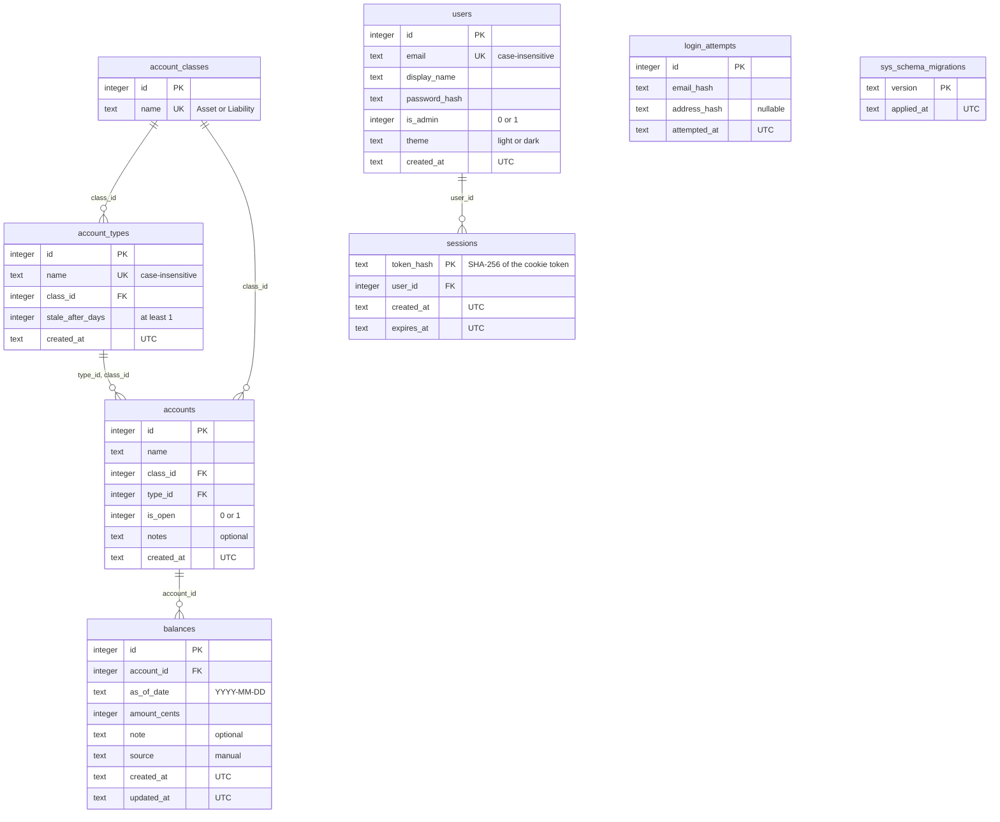

# Northstar: database schema

The SQLite schema as the migrations in `northstar/migrations/` build it. The migrations are the source of truth, and `tests/test_schema_diagram.py` fails when this diagram and a migrated database disagree about tables, columns, types, keys or relationships, so a schema change cannot ship without updating it. The rules the data must obey are in `spec.md`.

## Conventions

- Money is integer cents. A balance date is a calendar date, `YYYY-MM-DD`, with no timezone. Row timestamps are UTC text, `YYYY-MM-DDTHH:MM:SSZ`.
- `is_open` and `is_admin` are 0 or 1, because SQLite has no boolean type.
- `sys_schema_migrations` is created by the migration runner in `northstar/db.py`, not by a migration file. Releases before 0.2 called it `schema_migrations`, and the runner renames it (keeping its rows) the first time a newer version starts, after a backup.
- `login_attempts` has no relationships on purpose: it keeps only hashes of the email and the address, never the typed values.

## What the diagram cannot show

A person checks these against the migrations, because the test cannot read them from the diagram.

| Table | Constraint |
|---|---|
| `account_classes` | Exactly two rows, Asset (1) and Liability (2), inserted by the first migration. |
| `account_types` | `UNIQUE (id, class_id)`, which is the target of the composite key from `accounts`. The first migration also inserts the 11 starting types. |
| `accounts` | `FOREIGN KEY (type_id, class_id)` references `account_types (id, class_id)` with `ON UPDATE RESTRICT ON DELETE RESTRICT`, so an account's type always belongs to its class, and a type in use can be neither deleted nor moved to another class. |
| `balances` | `UNIQUE (account_id, as_of_date)`: one balance per account per date. `as_of_date` must be a valid date. Deleting an account cascades to its balances. |
| `sessions` | Deleting a user cascades to their sessions. Index `sessions_user_id` on `user_id`. |
| `login_attempts` | Indexes on `(email_hash, attempted_at)` and `(address_hash, attempted_at)`. |
